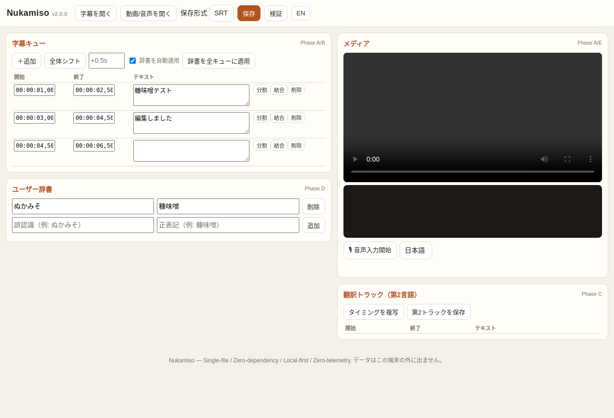

# Nukamiso

音声入力で字幕を作り、編集し、書き出すための**単一ファイル HTML 字幕エディタ**です。
`nukamiso.html` をブラウザで開くだけで動きます。インストールも、サーバーも、アカウントもありません。

A **single-file HTML subtitle editor**: dictate subtitles with your voice, edit them, and export.
Just open `nukamiso.html` in a browser. No install, no server, no account.



## 哲学 (Philosophy)

非交渉原則 — これらを破る変更は受け入れません。

- **Single-file** — 本体は `nukamiso.html` ひとつだけ
- **Zero-dependency** — 外部ライブラリ・CDN・Web フォントを一切読み込まない
- **Local-first** — データは端末内（localStorage）だけに保存される
- **Zero-telemetry** — 通信は一切しない（CSP で `connect-src 'none'` を強制）

## 機能 (Features)

| Phase | 機能 |
|---|---|
| A | 音声入力（Web Speech API）。確定結果がタイムスタンプ付き字幕行になる。非対応ブラウザでは手入力で全機能が使える |
| B | SRT / VTT / ASS / TXT の読み込みと書き出し（往復で意味を保存） |
| C | 翻訳ペイン: 第2言語トラックを並べて編集（外部 API 不使用、辞書置換で支援） |
| D | ユーザー辞書: 誤認識→正表記の置換ルール。認識結果と読み込んだ字幕に適用 |
| E | 波形ビュー: Web Audio API + canvas の自前実装（`NK.wave` に隔離、WaveSurfer.js 等の外部依存なし） |
| F | テスト: Node 単体テスト + ランダム往復 fuzz + Electron 実 UI テスト |
| G | 配布: Tauri 2.x の殻（`src-tauri/`）とタグ駆動のリリース workflow |

その他: 字幕の検証（`nkValidate` — 時刻逆行・重なり・長すぎる行などを指摘）、
キューの追加・削除・分割・結合・全体シフト、動画/音声ファイルの再生と現在行ハイライト、
File System Access API による保存（非対応環境ではダウンロードにフォールバック）、
日本語/英語 UI 切替、作業状態の自動保存（localStorage）。

## 使い方 (Usage)

1. `nukamiso.html` をブラウザで開く
2. 「動画/音声を開く」でメディアを読み込む（任意）
3. 🎙「音声入力開始」で話すか、「字幕を開く」で既存字幕を読み込むか、表で直接編集する
4. 形式を選んで「保存」

## テスト (Tests)

```sh
node tests/run-tests.js          # コアロジック単体 + fuzz（依存ゼロ）
# 実 UI テスト（Electron 34 + Xvfb が必要）:
xvfb-run -a <electron-binary> tests/ui-main.js --no-sandbox
```

## デスクトップ版 (Tauri)

`src-tauri/` に Tauri 2.x の殻があります。同じ `nukamiso.html` をそのまま内包します。

```sh
cd src-tauri && cargo build
```

タグ（`v*`）を push すると `.github/workflows/release.yml` が各 OS 向けにビルドします。

> **署名について**: リリースバイナリは**未署名**です。コード署名（Apple Developer /
> Azure Trusted Signing）は年間費用がかかるため行っていません。OS の警告が出る場合は、
> その旨を理解したうえで実行してください。ソースから自分でビルドすることもできます。

## プライバシー

データ収集は一切ありません。詳細は [PRIVACY.md](PRIVACY.md) を参照してください。

## License

MIT — see [LICENSE](LICENSE).
